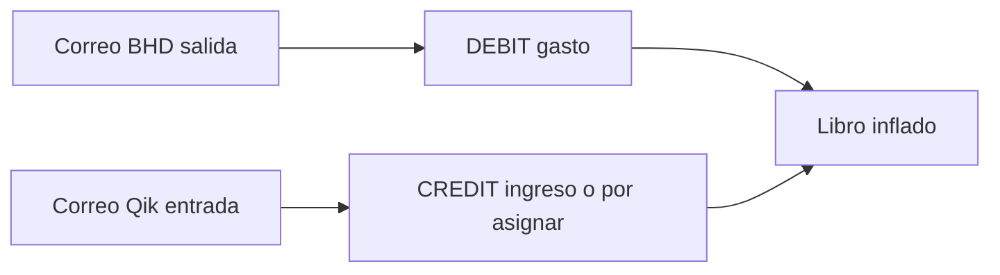

# Hallazgos del sync de correos bancarios

## Qué dice el correo de nómina

[docs/Notificación Depósito de Nómina.eml](docs/Notificación Depósito de Nómina.eml) es un HTML de `notificaciones@popularenlinea.com`, asunto **Notificación Depósito de Nómina** (15 sep 2026). El texto útil es:

- Destinatario: COLLADO TERRERO JA
- Cédula enmascarada: `XXX-XXXX-3695` (no es la cuenta)
- “ha sido acreditado el pago de su nómina en su cuenta terminada en **3447**”
- No hay monto, ni fecha del depósito, ni comercio

El resto es marketing de la App Popular.

## Por qué el sync no lo deja como movimiento

El pipeline en [process-gmail-sync.use-case.ts](personal-os-back/src/modules/finance/ingestion/application/process-gmail-sync.use-case.ts) solo crea un movimiento si el modelo devuelve `kind: "transaction"` con **monto positivo** y un destino **único**.

El prompt en [ai-email-transaction.extractor.ts](personal-os-back/src/modules/finance/ingestion/infrastructure/ai-email-transaction.extractor.ts) dice explícitamente que nómina es transacción, y a la vez: **no inventar montos**. El esquema Zod exige `amount` positivo. Con este correo el modelo solo puede:

- Devolver `not_transaction` → queda `SKIPPED_NOT_TX` (se ve en el historial de correos, no en el libro).
- Inventar un monto o un JSON inválido → `FAILED_NON_RETRYABLE` o un importe falso.

Además, si ya se guardó con cualquiera de esos outcomes, el dedup por `gmailMessageId` **no lo vuelve a leer**. Hace falta borrar esa fila y un sync completo (`forceFullSync`), como indica [gmail-sync.md](personal-os-back/docs/modules/finance/operations/gmail-sync.md).

Un defecto aparte empeora todos los correos HTML de una sola parte (este lo es: `Content-Type: text/html`). En [gmail-api.util.ts](personal-os-back/src/modules/finance/ingestion/infrastructure/gmail-api.util.ts) el HTML solo se limpia en partes anidadas. Si el cuerpo viene en `payload.body`, el modelo recibe tablas y estilos crudos. Ahí es fácil confundir la cédula `3695` con la cuenta `3447`.

## Por qué Qik se queda en “por asignar”

No hay parser por banco. El destino lo resuelve [resolve-email-ledger-target.ts](personal-os-back/src/modules/finance/ingestion/application/resolve-email-ledger-target.ts) solo dentro de la institución del source:

- Sin dígitos de cuenta y **un solo** producto activo → se asigna solo.
- Sin dígitos y **cuenta + tarjeta**, o varias cuentas → `ambiguous` → `PENDING_ASSIGNMENT`.
- Con dígitos que no son sufijo del `accountNumber` guardado (cédula, teléfono, referencia, o cuenta sin número cargado) → `none` → también `PENDING_ASSIGNMENT`.

Los correos de Qik suelen decir “recibiste / enviaste” sin terminación de cuenta. Si en esa institución hay más de un producto, o el modelo mete un número que no está guardado en la cuenta, el movimiento no entra al libro. El correo sí se procesó; el libro no tiene fila hasta que se asigna a mano.

## Transferencias entre bancos (BHD → Qik)

Hoy el extractor solo conoce `DEBIT` y `CREDIT`. No existe `TRANSFER` en la extracción. [category-type.ts](personal-os-back/src/modules/finance/shared/domain/category-type.ts) mapea débito a categoría de gasto e crédito a ingreso.

Secuencia actual:

El lado BHD se contabiliza como gasto en cuanto llega. El lado Qik, si no trae cuenta, queda por asignar o, si entra, como ingreso. No hay un segundo paso que los junte. El mismo dinero cuenta dos veces y con el signo equivocado.

Emparejar después **sí es factible**, y es mejor que decidir la transferencia con un solo correo:

- Al leer, clasificar el movimiento como compra, ingreso, nómina, retiro en cajero, transferencia saliente o entrante. Las transferencias y los retiros no llevan categoría de gasto ni de ingreso.
- Un pase posterior busca el par: mismo usuario, sentido opuesto, monto igual (o con tolerancia de comisión), fecha en una ventana corta, y contraparte que sea el propio titular u otra institución propia.
- Si hay un solo par, se unen con `transferGroupId` (el libro ya agrupa así las transferencias manuales). Si hay varios candidatos del mismo monto, se dejan para revisión.
- El correo que llega primero queda como “transferencia sin par”, no como gasto. Cuando llega el otro, se cierra el par.

No conviene una cuenta por defecto para tapar este caso: el problema no es la cuenta de Qik, es el tipo de movimiento.

## Movimientos por asignar actuales

Los que ya están en esa cola no se tocan solos. Cada fila `PENDING_ASSIGNMENT` guarda el extract (`DEBIT` o `CREDIT`, monto, texto) y no tiene movimiento en el libro. El sync no los relee (dedup por `gmailMessageId`). `POST pending/:id/retry` solo vuelve a correr [resolveEmailLedgerTarget](personal-os-back/src/modules/finance/ingestion/application/resolve-email-ledger-target.ts) con los hints ya guardados. Si ahora hay un destino único, los importa con el tipo viejo. Asignarlos a mano hace lo mismo: gasto o ingreso, no transferencia.

Qué hacer con esa cola, en este orden:

- No aplicar la cuenta predeterminada a esas filas hasta clasificar el texto guardado. Si no, una transferencia de Qik entra al libro como gasto o ingreso en la cuenta default.
- Un pase sobre las filas pendientes, sin volver a Gmail ni al modelo: si la descripción parece transferencia entre bancos, marcarla como transferencia sin par. Si parece retiro en cajero, el destino es la cuenta de efectivo, no otro banco.
- Si no parece transferencia y el único hueco es la cuenta, ahí sí usar la predeterminada o el retry, e importar.
- Los que ya se importaron como gasto (el lado BHD, por ejemplo) no están en esta cola. Esos se corrigen en el pase de empareje, no al asignar pendientes.

## Retiro en cajero

Hoy un correo de retiro en cajero se lee como `DEBIT` y, si la cuenta del banco se resuelve, entra como gasto. La cuenta `CASH` no se mueve. El efectivo queda invisible y, cuando después se registran gastos en efectivo, el mismo dinero puede contar dos veces.

No es una transferencia entre bancos. No llega un segundo correo. El destino es fijo: la cuenta de efectivo del usuario. El libro ya sabe armar eso con dos patas y un `transferGroupId` en [createTransfer](personal-os-back/src/modules/finance/ledger/infrastructure/prisma-ledger.repository.ts). La importación por correo hoy solo crea una pata.

Regla:

- Si el texto es retiro en cajero (no una transferencia a otra persona ni a otro banco) y hay **una** cuenta `CASH` activa, crear la transferencia: débito en la cuenta o tarjeta del banco, crédito en efectivo, sin categoría.
- Si no hay cuenta de efectivo, o hay varias, no adivinar. Dejar el retiro pendiente de esa pata.
- La comisión del cajero, si el correo la separa, sigue siendo gasto. El monto del retiro es la transferencia.
- En la cola actual y en los retiros ya importados como gasto: misma regla. Al corregir uno ya importado, no volver a debitar el banco; solo agregar el crédito en efectivo y unir las dos patas.

## Qué haría con la cuenta por defecto

Sí, pero solo como respaldo cuando el correo **no trae dígitos** y la institución tiene varias cuentas. Reglas:

- Un solo producto activo: seguir autoasignando (ya ocurre).
- Varias cuentas y sin dígitos: usar la cuenta marcada como predeterminada de esa institución.
- Dígitos presentes que no coinciden: **no** usar la predeterminada. Ahí el número guardado está mal, o el modelo leyó cédula/referencia. Mandarlo a la cuenta default ocultaría el error.
- En el prompt: `accountNumberHint` solo si el texto dice cuenta o “terminada en”. Nunca la cédula (`No. de identificación`).

En nómina, `3447` sí es un hint válido. Si esa cuenta está cargada con un número que termina en 3447, el destino se resuelve. El bloqueo real es el monto ausente.

Este correo además sale de `notificaciones@popularenlinea.com`. Hoy cada source tiene un solo `bankSenderEmail` y la consulta es `from:` esa dirección ([bank-sender.ts](personal-os-back/src/modules/finance/ingestion/application/bank-sender.ts)). Si Popular está ligado a otro remitente, Gmail ni lista este mensaje: no llega al modelo y no aparece en el historial.

## Remitentes: lista por institución (aceptado)

Filtrar por remitente, y no por el dominio, se mantiene. `from:popularenlinea.com` o `from:qik.com.do` mete avisos, eventos y promociones, gasta el tope del modelo y puede dejar transacciones reales para el siguiente sync.

El hueco es que [FinEmailSource](personal-os-back/prisma/schema.prisma) guarda un solo `bankSenderEmail`. Qik y Popular mandan movimientos desde varias direcciones del mismo dominio. [buildGmailFromQuery](personal-os-back/src/modules/finance/ingestion/application/bank-sender.ts) arma `from:` esa única dirección, así que las demás no se listan.

Decisión:

- Varios remitentes en el mismo source. La consulta Gmail queda `from:(notificaciones@popularenlinea.com OR otra@popularenlinea.com)`.
- Sigue habiendo un solo source por institución (la clave única ya es institución, no remitente). El campo único pasa a una lista; el dominio se sigue derivando de esas direcciones.
- No autoagregar direcciones. Un listado aparte, sin modelo, muestra los `From` distintos de ese dominio en los últimos días para que el usuario marque cuáles son de transacciones.
- No filtrar por palabras del asunto. El marketing también dice “depósito” o “nómina”, y un aviso real puede usar un asunto nuevo.

## Recomendación de implementación, en este orden

1. **Nómina sin monto.** Nuevo resultado (por ejemplo monto pendiente) guardado en el mensaje, con cuenta `3447` si matchea, para completar el importe a mano. No inventar el salario. Reprocesar filas ya marcadas `SKIPPED_NOT_TX` de este patrón.
2. **Limpiar HTML** también cuando el cuerpo está en `payload.body` con `text/html`, y prohibir usar la cédula como número de cuenta.
3. **Cola actual de por asignar.** Clasificar el texto ya guardado. Transferencias se quedan sin par. El resto, si solo falta la cuenta, usa la predeterminada.
4. **Cuenta predeterminada por institución**, solo si no hay dígitos, hay varias cuentas y el movimiento no es una transferencia. No correrla sobre la cola vieja antes del paso 3.
5. **Retiro en cajero.** Transferencia inmediata a la única cuenta `CASH`. Sin segundo correo. Corregir los ya importados como gasto sin debitar el banco otra vez.
6. **Clase de movimiento + empareje de transferencias** entre instituciones, sin contabilizar la salida como gasto mientras no haya par o el usuario la confirme. Incluye los ya importados como gasto. El retiro en cajero no entra en este empareje.
7. **Varios remitentes por institución.** Allowlist en la consulta Gmail. Descubrimiento de otras direcciones del dominio sin llamar al modelo, y el usuario elige cuáles agregar.
