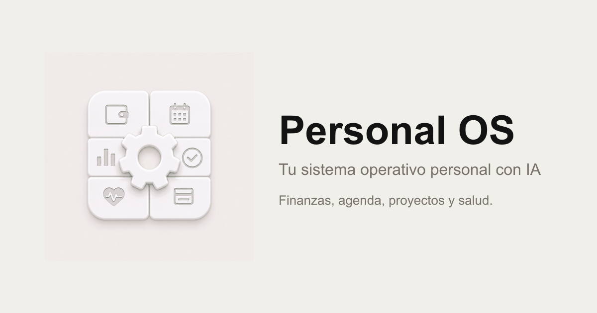
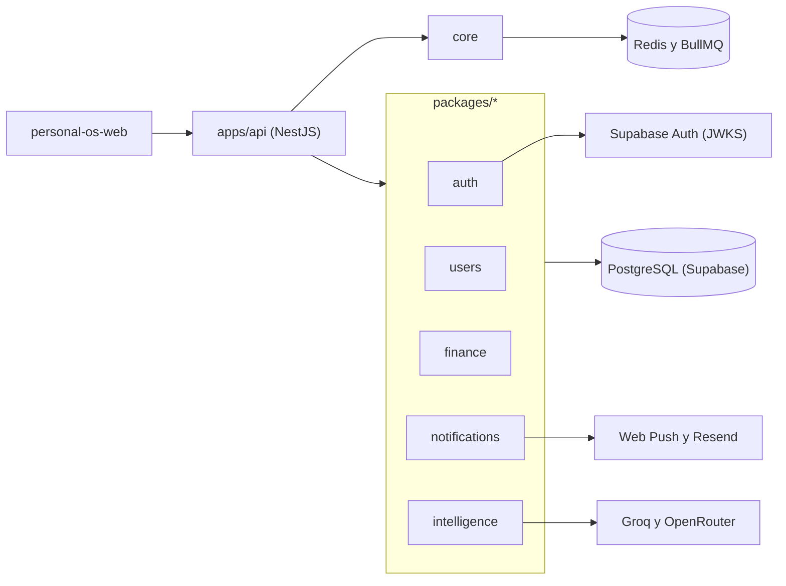

<p align="center">
  
</p>

<h1 align="center">Personal OS — Backend</h1>

<p align="center">
  API de finanzas personales, usuarios, notificaciones y agente de IA para Personal OS.
</p>

<p align="center">
  
  
  
  
  
  
  
  
</p>

**Estado:** beta (`0.x`). Política de versiones en [docs/versionado.md](./docs/versionado.md).

## Qué es

API NestJS de Personal OS. Expone el dominio de finanzas, la autenticación, los usuarios, las notificaciones y el agente de IA. Un solo backend desplegable, un proceso y una base PostgreSQL.

**Finanzas** es el módulo con más superficie: instituciones, cuentas, tarjetas, ledger de movimientos, transferencias, estados de cuenta, presupuestos, metas de ahorro, préstamos, cobros, suscripciones, importación de extractos, conciliación y analítica. Está pensado para cuentas en pesos dominicanos y dólares en bancos como Popular, BHD, Banreservas, Qik y APAP.

Cada usuario activa sus apps (`finance`, `agenda`, `projects`, `health`) y la API aplica ese estado. Agenda, Proyectos y Salud todavía son configuración: no tienen controllers propios.

## Módulos

| Módulo        | Paquete                  | Qué hace                                                                    |
| ------------- | ------------------------ | --------------------------------------------------------------------------- |
| Auth          | `packages/auth`          | Valida el JWT de Supabase por JWKS y administra usuarios de Auth.           |
| Users         | `packages/users`         | Perfil, preferencias, apps activas y vaciado de datos por usuario.          |
| Finance       | `packages/finance`       | Ledger, catálogo, planeación, analítica, conciliación e ingesta de correo.  |
| Notifications | `packages/notifications` | Bandeja, push, correo, WebSocket y entrega de eventos.                      |
| Intelligence  | `packages/intelligence`  | Inferencia estructurada, inteligencia de correo, consentimiento y acciones. |
| Logos         | `packages/logos`         | Logos de instituciones y comercios.                                         |

## Base compartida

| Paquete              | Contenido                                                                |
| -------------------- | ------------------------------------------------------------------------ |
| `packages/config`    | Entorno validado con Zod y límites de IA.                                |
| `packages/contracts` | Interfaces y tokens neutrales de inferencia, eventos y capacidades.      |
| `packages/database`  | Prisma, cliente generado, pool de PostgreSQL y migraciones.              |
| `packages/core`      | Guards, filtros, envelope `{ data, meta }`, eventos, colas y paginación. |

## Arquitectura

Los módulos son paquetes del workspace y la app Nest los consume por `@personal-os/*`. Un paquete importa a otro solo por su barrel; ESLint y `tsc -b` lo verifican. El esquema Prisma es único y su dueño es `packages/database`. Los efectos secundarios salen por un outbox y colas BullMQ, no dentro del request.



La API exige JWT en cada request, usa RLS en las tablas de finanzas y responde con el envelope `{ data, meta }`. El prefijo es `/api`; health, Swagger y Bull Board viven fuera o solo en desarrollo.

Detalle en [docs/architecture/monorepo.md](./docs/architecture/monorepo.md) e [docs/infrastructure/overview.md](./docs/infrastructure/overview.md).

## Arranque rápido

Requisitos: Node 20+, pnpm, PostgreSQL (Supabase) con Auth, Redis opcional en local y obligatorio en producción, y al menos una API key de `GROQ_API_KEY` o `OPENROUTER_API_KEY`.

```bash
cp .env.example .env
pnpm install
pnpm db:generate
pnpm start:dev
```

- API: `http://localhost:$PORT/api` (por defecto `3100`)
- Swagger: `http://localhost:$PORT/docs`, apagado en producción
- Bull Board: `http://localhost:$PORT/admin/queues`, solo en desarrollo con Redis

Detalle de variables y pasos en [docs/operations/quick-start.md](./docs/operations/quick-start.md).

## Scripts

| Script                  | Qué hace                                                                |
| ----------------------- | ----------------------------------------------------------------------- |
| `pnpm start:dev`        | Compila los paquetes y levanta Nest en watch                            |
| `pnpm build`            | Genera Prisma, compila paquetes y Nest, y sube sourcemaps a Sentry      |
| `pnpm test`             | Pruebas de unidad con Jest                                              |
| `pnpm test:e2e`         | Pruebas E2E con Prisma simulado                                         |
| `pnpm test:integration` | Pruebas de integración contra un PostgreSQL local (`TEST_DATABASE_URL`) |
| `pnpm lint`             | ESLint type-aware; requiere los paquetes compilados                     |
| `pnpm format:check`     | Prettier sobre TypeScript y Markdown                                    |
| `pnpm db:generate`      | Genera el cliente Prisma                                                |
| `pnpm db:migrate`       | Aplica migraciones en desarrollo                                        |
| `pnpm db:studio`        | Abre Prisma Studio                                                      |

## Documentación

| Documento                                                | Para qué                                             |
| -------------------------------------------------------- | ---------------------------------------------------- |
| [docs/README.md](./docs/README.md)                       | Mapa completo de la documentación                    |
| [docs/modules/](./docs/modules/README.md)                | Una guía por módulo: capacidades, reglas y contratos |
| [docs/architecture/](./docs/architecture/README.md)      | Estructura Nest, monorepo y frontera pública         |
| [docs/infrastructure/](./docs/infrastructure/README.md)  | Config, base de datos, eventos, colas y seguridad    |
| [docs/operations/](./docs/operations/README.md)          | Arranque, entorno, pruebas y CI                      |
| [docs/decisions/](./docs/decisions/README.md)            | Decisiones de arquitectura (ADR)                     |
| [docs/glosario.md](./docs/glosario.md)                   | Qué se llama App en la interfaz y módulo en código   |
| [AGENTS.md](./AGENTS.md)                                 | Flujo de trabajo y fuentes canónicas                 |
| [docs/issue-conventions.md](./docs/issue-conventions.md) | Cómo se escriben los issues                          |

## Repositorios

| Repositorio                                                            | Rol                                     |
| ---------------------------------------------------------------------- | --------------------------------------- |
| [personal-os-back](https://github.com/jarvinc3/personal-os-back)       | API NestJS y dominio (este repositorio) |
| [personal-os-web](https://github.com/jarvinc3/personal-os-web)         | Cliente web Next.js                     |
| [personal-os-landing](https://github.com/jarvinc3/personal-os-landing) | Sitio público y páginas legales         |

## Licencia

MIT. Ver [LICENSE](./LICENSE).
