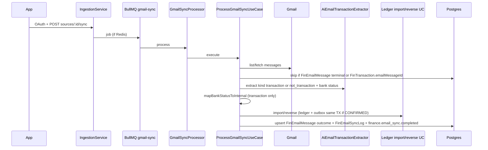

# Finance Module (Backend)

## Purpose

Personal finance domain for **Personal OS**: consolidate accounts, cards, and cash positions; record and categorize transactions; plan budgets and savings; track loans and receivables; and optionally import bank activity from **Gmail notification emails**. All data is scoped per authenticated user with Row Level Security (RLS) on Supabase/Postgres.

The module is consumed by:

- REST API under `/finance` (capability controllers)
- Mobile app (`personal-os-app`)
- AI agent tools when `moduleSlug=finance` (see `docs/ai-tools/finance-tools.md`) via **`FinanceFacade` only**

## Architecture

Capability-first Nest modules under `src/modules/finance/`. The root is a **pure composition root**. House standard: [docs/architecture/modules.md](../architecture/modules.md).

`FinanceModule` imports capability modules and **exports only `FinanceFacade`** from Nest. The TypeScript barrel [`index.ts`](../../src/modules/finance/index.ts) is the cross-module import surface:

- `FinanceModule`, `FinanceFacade` — primary consumers (AI tools, app composition)
- `FinanceEventsModule`, `DomainEventIdempotencyGuard` — outbox consumers (notifications, ai-agent listeners)

There is no `FinanceService` / `FinanceRepository` / single god controller. Outside code must not import capability paths (`ledger/`, `events/`, …).

### Canonical shape per capability

```text
capability/
  capability.module.ts
  presentation/       # controllers + dto/ (omit if internal-only)
  application/        # services and/or use-cases; ports/ when needed
  infrastructure/     # Prisma repos, external adapters
```

Shared pure rules live in `shared/domain/` (`Money`, ledger rules, mappers). Do **not** invent empty per-capability `domain/` folders until a capability owns rules that are not shared.

### Use-case vs fat service

| Style | When | Examples today |
| --- | --- | --- |
| **Use-cases** (`*.use-case.ts`) | Distinct write flows with different rules/orchestration | ledger writes, ingestion sync, FX `ResolveAmountsUseCase` |
| **Fat application service** | CRUD / read-heavy or a single cohesive API surface | catalog, planning, analytics |
| **Ports** | Cross-capability contract or ≥2 adapters | `LEDGER_REPOSITORY`, `BUDGET_THRESHOLD_PORT`, FX / email extractor ports |

Query-only surfaces (e.g. `LedgerQueryService`) stay as services even when writes are use-cases.

### Ledger vs side effects

- **Ledger** write use-cases orchestrate FX + `LEDGER_REPOSITORY`; **`LedgerQueryService` only lists/gets**.
- **Ledger** mutators run **synchronously** inside one `prisma.$transaction`: transaction row + balances + budget `amountSpent` + outbox row(s) + optional threshold side effects via `BUDGET_THRESHOLD_PORT`.
- **Delete transaction**: hard-deletes and restores balances in the same TX. **No domain event** is enqueued (notification/AI listeners do not act on delete today). Use reverse if you need an auditable compensating entry.
- **Email sync completed**: `FinEmailSyncLog` + `finance.email_sync.completed` outbox row land in the **same** `$transaction` as the sync success path.
- **Side effects** (notifications, AI insights, WebSocket) run **after commit** via `DomainEventOutbox` → `FinanceOutboxDispatcher` (cron every 30s + wake after write) → `EventEmitter2`.
- Listeners call `DomainEventIdempotencyGuard.tryClaim(eventId, consumer)` before acting.
- Not event sourcing: outbox is delivery durability only.

### Dependency rules

- Outside code imports **`FinanceFacade`** only (AI tools already do).
- Ledger does **not** import full Planning module; it uses `FinancePlanningThresholdModule` + `BUDGET_THRESHOLD_PORT`.
- Ingestion orchestrates extractor + FX + ledger import/reverse use-cases; `GmailSyncProcessor` only calls `ProcessGmailSyncUseCase`.

## Features

| Area | Capability |
| --- | --- |
| Institutions | User-defined banks/fintechs; soft-delete via `isActive` |
| Accounts | Checking, savings, cash, investment; single currency + balance; optional institution; **not** credit cards |
| Cards | Credit/debit per institution; multi-currency balances + credit limit on `FinCardBalance`; statement days on card |
| Transactions | Manual CRUD (`DEBIT`/`CREDIT`); transfers via dedicated endpoint; filters; confirm `PENDING` |
| Categories | System + custom; hierarchical (`parentId`); used by budgets and transactions |
| Budgets | Per category and period; spent tracking; threshold alerts deduped in `FinBudgetAlert` |
| Savings goals | Target amount, progress, completion (`isCompleted` recalculated on amount changes) |
| Loans / receivables | Installments and money owed |
| Gmail sync | OAuth2, encrypted tokens, BullMQ job, **AI extraction** (no bank HTML parsers) |
| Analytics | Net worth, cash flow, spending by category, budget status |
| FX | Live historical rates via **exchangerate.host**; cache in `FinExchangeRate` (exact date only) |

**Out of scope (today):** open banking APIs, automatic balance reconciliation from bank cores.

## Data model

Prefix: `fin_*` tables. Primary keys are UUID text columns.

### Core tables (selected)

| Model | Description |
| --- | --- |
| `FinTransaction` | Ledger row; XOR account/card; unique `emailMessageId`; original + ledger + base amounts |
| `FinEmailMessage` | Per-source Gmail message outcome (`IMPORTED` / `SKIPPED_NOT_TX` / `FAILED_NON_RETRYABLE`); unique `(sourceId, gmailMessageId)` |
| `FinExchangeRate` | Cached pair rates by calendar date |
| `FinBudgetAlert` | Threshold alerts; unique `(budget_id, type)` for dedupe |
| `DomainEventOutbox` | Durable domain events |
| `ProcessedDomainEvent` | Consumer idempotency (`eventId` + `consumer`) |

### Transaction amount fields

| Field | Meaning |
| --- | --- |
| `amount` / `currency` | Original amount as entered or extracted |
| `ledgerAmount` / `ledgerCurrency` | Amount applied to account/card balance |
| `amountBaseCurrency` / `exchangeRate` | Analytics normalization (`BASE_CURRENCY`) |

FX fails closed: if the exact historical rate for `transactionDate` is missing from cache and API, the operation returns 400 — no stale “latest” rate.

### Enums (transactions)

| Enum | Values |
| --- | --- |
| `FinTransactionType` | `DEBIT`, `CREDIT`, `TRANSFER` (transfer type used on paired legs) |
| `FinTransactionStatus` | `PENDING`, `CONFIRMED`, `DECLINED`, `CANCELLED`, `REVERSED` |
| `FinTransactionSource` | `MANUAL`, `EMAIL`, `AI` |
| `FinEmailMessageOutcome` | `IMPORTED`, `SKIPPED_NOT_TX`, `FAILED_NON_RETRYABLE` |

User language **COMPLETED** maps to **CONFIRMED** (no `COMPLETED` enum value).

### Transaction rules

- **Target XOR**: exactly one of `accountId` or `cardId`.
- **Ledger effects** only when status is `CONFIRMED` (create or confirmation path).
- `POST /transactions` accepts `type` `DEBIT` \| `CREDIT` only; use `POST /transfers` for moves.
- Email import status comes from **bank status mapping** (domain), not always `PENDING`.
- Manual defaults: `CONFIRMED`, `source=MANUAL`. AI tools create with `source=AI`.

### Bank status → internal status (email)

AI extractor returns `bankStatusNormalized` + `statusConfidence`. Domain rules (`shared/domain/transaction-status.ts`):

| Confidence / bank status | Internal |
| --- | --- |
| confidence &lt; 0.7 or `UNKNOWN` | `PENDING` |
| `APPROVED` / `COMPLETED` / `POSTED` | `CONFIRMED` (ledger) |
| `PENDING` / `IN_PROGRESS` / `AUTHORIZED` | `PENDING` |
| `DECLINED` / `REJECTED` / `FAILED` | `DECLINED` |
| `CANCELLED` / `VOIDED` | `CANCELLED` |
| `REVERSED` / `REFUNDED` / `CHARGEBACK` | reverse original if found + `REVERSED` |

Evidence and model metadata stored in `aiMetadata`.

## API endpoints

Base path: `/finance`. Auth: Bearer JWT (`@ApiBearerAuth`). Controllers are split by capability; HTTP paths and `{ data, meta }` envelope are unchanged relative to the prior monolithic controller.

| Area | Controllers |
| --- | --- |
| Ledger | `TransactionsController`, `TransfersController` |
| Catalog | Institutions, Accounts, Cards, Categories |
| Planning | Budgets, Savings goals, Loans, Receivables |
| Analytics | `AnalyticsController` (`summary`, spending, budget-status) |
| Ingestion | `EmailSyncController` (OAuth + sources + sync) |

Public OAuth callback remains on the email-sync controller. After Google consent the API redirects:

- **Mobile (default):** `personal-os://finance/oauth/callback?success=1|false`
- **Web:** pass `returnTo` (https URL whose origin is in `CORS_ORIGIN`) when requesting `GET /finance/email-sync/oauth/google/url`. The signed `state` carries `returnTo` plus optional `accountId` **xor** `cardId`. The callback then 302s to `{returnTo}?success=true|false`. Invalid or missing `returnTo` falls back to the mobile deep link (no open redirect).

## Gmail sync pipeline



| Step | Behavior |
| --- | --- |
| Preconditions | Source active; linked account **or** card; refreshable token |
| Query | `from:{bankDomain}` + `after` unless `forceFullSync` |
| Dedup | Skip if `FinEmailMessage` already has a terminal outcome, or existing `FinTransaction.emailMessageId` (legacy) |
| Extraction | LLM + Zod discriminated union (`kind: transaction` \| `not_transaction`); no HTML parsers |
| Non-tx / failures | `not_transaction` → `SKIPPED_NOT_TX`; `ok: false` + `retryable: false` → `FAILED_NON_RETRYABLE` (no re-extract); `retryable: true` not persisted |
| Status | Domain map from bank status + confidence (transaction kind only) |
| Batch AI/notifications | Prefer `finance.email_sync.completed` over per-email storms for EMAIL source |

Without Redis, `POST .../sync` returns `{ queued: false, reason: '...' }`.

## Domain events

**Versioned names only** (no dual legacy enqueue). Written to `domain_event_outbox` then dispatched:

| Event | Consumers |
| --- | --- |
| `finance.transaction.confirmed` / `imported` / `declined` / `cancelled` / `reversed` | Notifications, AI (EMAIL per-row insights skipped; batch sync used) |
| `finance.transaction.updated` | Notifications, AI |
| `finance.budget.threshold_crossed` | Notifications, AI (once per budget/type via alerts table) |
| `finance.email_sync.completed` | AI batch insight |
| `finance.transfer.created` | Outbox for transfer aggregate |
| `finance.email_sync.failed` | Ops / future consumers |

Catalog: `src/core/events/event.constants.ts`.

## Environment

| Variable | Purpose |
| --- | --- |
| `GOOGLE_CLIENT_ID` / `GOOGLE_CLIENT_SECRET` / `GOOGLE_REDIRECT_URI` | Gmail OAuth |
| `ENCRYPTION_KEY` | ≥32 chars; OAuth token encryption |
| `REDIS_ENABLED` + `REDIS_URL` | BullMQ for Gmail sync and AI processing |
| `EXCHANGE_RATE_HOST_API_KEY` | exchangerate.host historical rates |
| `BASE_CURRENCY` | Analytics base (e.g. `DOP`) |

## AI integration

Tools call **`FinanceFacade`** (not raw repositories). Full tool list: `docs/ai-tools/finance-tools.md`.

Email extraction uses `AiService.chatComplete` via `AiEmailTransactionExtractor` (`EMAIL_TRANSACTION_EXTRACTOR` token). Ingestion imports `AiCoreModule` (AI provider kernel) rather than `AiModule`, so there is no Nest cycle with Finance. The extractor injects `AiService` directly (no `forwardRef`).

## Security

- RLS on user-owned finance tables.
- Gmail tokens encrypted; OAuth state JWT-bound.
- Gmail scope is read-only mail.

## Smoke checklist (HTTP real)

Target: Nest local + real `DATABASE_URL` + FX key + real user JWT. **Not** a live Gmail cycle.

```bash
# 1) API running with DATABASE_URL, EXCHANGE_RATE_HOST_API_KEY, BASE_CURRENCY
# 2) User with ≥2 accounts (script creates them if missing)

SMOKE_BASE_URL=http://127.0.0.1:3000/api \
SMOKE_JWT=<jwt> \
pnpm exec ts-node -r tsconfig-paths/register prisma/scripts/smoke-finance-http.ts
```

Script covers: multi-currency create → PENDING + confirm → transfer → outbox rows for `finance.transaction.*` / `finance.transfer.created` → cleanup of tagged smoke rows. Success prints `{"SMOKE_RESULT":"PASS"}`.

**Last smoke run (2026-08-07):** PASS against local Nest with a real Supabase JWT (or e2e HS256 overrides via `test/helpers/auth-test.providers.ts` — never `NODE_ENV=test` on the production auth path), port 3456, real Supabase `DATABASE_URL` + FX. Observations:

- Multi-FX DEBIT USD on DOP account → 201; `ledgerAmount` 145.63 (≠ raw amount)
- PENDING create + confirm → CONFIRMED
- Transfer group `f108dadc-…` → 201
- Outbox: 7 rows (`finance.transaction.*`, `finance.transfer.created`) status `COMPLETED` after dispatcher wake
- Cleanup: 4 txs + 2 smoke accounts deleted

Automated substitute without live HTTP: `pnpm test:e2e --testPathPatterns=finance` (Prisma mock).

## Related documentation

- App UI: `personal-os-app/docs/modules/finance.md`
- AI tools: `docs/ai-tools/finance-tools.md`
- Core events/outbox overview: `docs/core-infrastructure.md`
- Migration: `prisma/migrations/20260807120000_finance_hexagonal_events_fx/`
- HTTP smoke script: `prisma/scripts/smoke-finance-http.ts`
