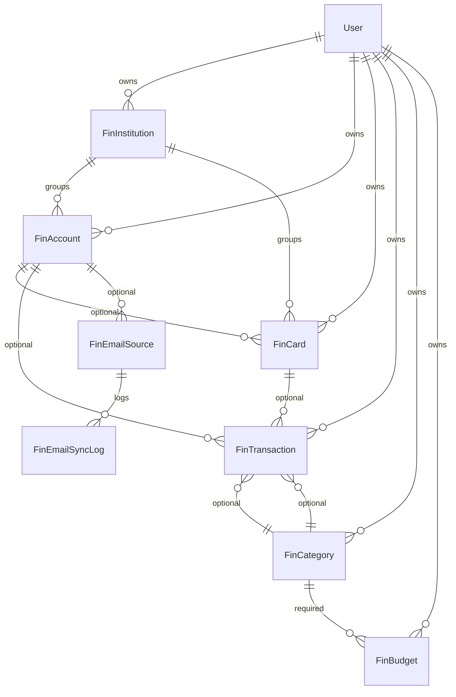
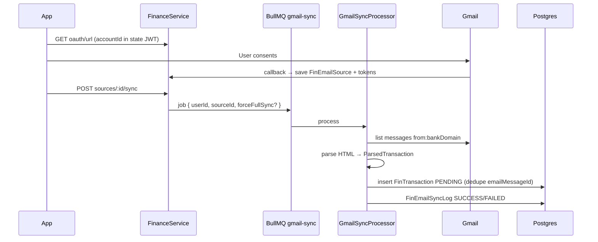

# Finance Module (Backend)

## Purpose

Personal finance domain for **Personal OS**: consolidate accounts, cards, and cash positions; record and categorize transactions; plan budgets and savings; track loans and receivables; and optionally import bank activity from **Gmail notification emails** (Dominican banks). All data is scoped per authenticated user with Row Level Security (RLS) on Supabase/Postgres.

The module is consumed by:

- REST API (`FinanceController`)
- Mobile app (`personal-os-app`)
- AI agent tools when `moduleSlug=finance` (see `docs/ai-tools/finance-tools.md`)

## Features

| Area           | Capability                                                                                                     |
| -------------- | -------------------------------------------------------------------------------------------------------------- |
| Institutions   | User-defined banks/fintechs; soft-delete via `isActive`                                                        |
| Accounts       | Checking, savings, cash, investment; multi-currency balance; optional link to institution                      |
| Cards          | Credit/debit per institution; multi-currency balances; optional link to account                                |
| Transactions   | Manual CRUD; filters (account, card, type, status, dates, search); confirm `PENDING`                           |
| Categories     | System + custom; hierarchical (`parentId`); used by budgets and transactions                                   |
| Budgets        | Per category and period (`MONTHLY`, `BIWEEKLY`, `CUSTOM`); spent tracking and alert threshold                  |
| Savings goals  | Target amount, progress, completion                                                                            |
| Loans          | Installment tracking, balance, optional linked account                                                         |
| Receivables    | Money owed to the user (`PENDING` → `PAID`, etc.)                                                              |
| Gmail sync     | OAuth2, encrypted tokens, BullMQ job, bank HTML parsers → `PENDING` transactions                               |
| Analytics      | Net worth, cash flow, spending by category, budget status                                                      |
| Exchange rates | `FinExchangeRate` table (reference data; conversion on transactions via `exchangeRate` / `amountBaseCurrency`) |

**Out of scope (today):** open banking APIs, automatic balance reconciliation from bank cores, push notifications for budget alerts (schema supports `FinBudgetAlert`).

## Data model

Prefix: `fin_*` tables. Primary keys are UUID text columns.

### Entity relationship (simplified)

### Core tables

| Model                 | Table                    | Description                                                        |
| --------------------- | ------------------------ | ------------------------------------------------------------------ |
| `FinInstitution`      | `fin_institutions`       | Bank/fintech label, color, logo, country                           |
| `FinAccount`          | `fin_accounts`           | Account type, currency, balance, credit metadata                   |
| `FinCard`             | `fin_cards`              | Card metadata, statement days, link to institution/account         |
| `FinCardBalance`      | `fin_card_balances`      | Per-card, per-currency balance and credit limit                    |
| `FinTransaction`      | `fin_transactions`       | Amount, type, status, source, optional `emailMessageId` (unique)   |
| `FinCategory`         | `fin_categories`         | User or system category; tree via `parentId`                       |
| `FinBudget`           | `fin_budgets`            | Limit/spent for category + period; unique per user/category/period |
| `FinBudgetAlert`      | `fin_budget_alerts`      | Threshold notifications (persisted; delivery TBD)                  |
| `FinSavingsGoal`      | `fin_savings_goals`      | Target vs current amount                                           |
| `FinLoan`             | `fin_loans`              | Lender, installments, balances                                     |
| `FinReceivable`       | `fin_receivables`        | Debtor, amount, paid portion, status                               |
| `FinEmailSource`      | `fin_email_sources`      | Gmail connection, `bankDomain`, encrypted OAuth tokens             |
| `FinEmailSyncLog`     | `fin_email_sync_logs`    | Per-sync scan/create counts and errors                             |
| `FinRecurringPattern` | `fin_recurring_patterns` | Detected recurring spend (AI/analysis; not fully exposed in API)   |
| `FinExchangeRate`     | `fin_exchange_rates`     | Daily rates by currency pair                                       |

### Enums

| Enum                   | Values                                            |
| ---------------------- | ------------------------------------------------- |
| `FinAccountType`       | `CHECKING`, `SAVINGS`, `CASH`, `INVESTMENT`       |
| `FinCardType`          | `CREDIT`, `DEBIT`                                 |
| `FinCardNetwork`       | `VISA`, `MASTERCARD`, `AMEX`, `DISCOVER`, `OTHER` |
| `FinTransactionType`   | `DEBIT`, `CREDIT`, `TRANSFER`                     |
| `FinTransactionStatus` | `PENDING`, `CONFIRMED`, `CANCELLED`               |
| `FinTransactionSource` | `MANUAL`, `EMAIL`, `AI`                           |
| `FinBudgetPeriodType`  | `MONTHLY`, `BIWEEKLY`, `CUSTOM`                   |
| `FinInstallmentFreq`   | `WEEKLY`, `BIWEEKLY`, `MONTHLY`                   |
| `FinReceivableStatus`  | `PENDING`, `PARTIAL`, `PAID`, `CANCELLED`         |
| `FinEmailSyncStatus`   | `RUNNING`, `SUCCESS`, `FAILED`                    |

### Transaction rules

- **`amount`**: value in transaction `currency`.
- **`amountBaseCurrency`**: normalized amount for analytics (default currency aggregation).
- **`emailMessageId`**: Gmail message id; unique constraint prevents duplicate imports.
- Email sync creates rows with `status=PENDING`, `source=EMAIL`; user confirms via `POST .../confirm`.
- Manual transactions default to `CONFIRMED`, `source=MANUAL`.

## Module structure

| Path                             | Role                                                      |
| -------------------------------- | --------------------------------------------------------- |
| `finance.module.ts`              | Nest module; registers queue processor when Redis enabled |
| `finance.controller.ts`          | HTTP routes under `/finance`                              |
| `finance.service.ts`             | Business logic, OAuth, analytics, queue enqueue           |
| `finance.repository.ts`          | Prisma access                                             |
| `gmail-sync.processor.ts`        | BullMQ worker (`QueueNames.GMAIL_SYNC`)                   |
| `email-parsers/`                 | Bank-specific HTML parsers + registry + fixtures/tests    |
| `dto/`                           | Request validation                                        |
| `utils/gmail-api.util.ts`        | Gmail list/get/parse helpers                              |
| `utils/token-encryption.util.ts` | AES encrypt/decrypt for OAuth tokens                      |

Schema source: `prisma/schema.prisma` (models `Fin*`).

## API endpoints

Base path: `/finance`. Auth: Bearer JWT (`@ApiBearerAuth`).

### Institutions

- `GET /finance/institutions`
- `POST /finance/institutions`
- `PATCH /finance/institutions/:id`
- `DELETE /finance/institutions/:id` — deactivates (`isActive=false`)

### Accounts

- `GET /finance/accounts`
- `POST /finance/accounts`
- `GET /finance/accounts/:id`
- `PATCH /finance/accounts/:id`

### Cards

- `GET /finance/cards`
- `POST /finance/cards`
- `GET /finance/cards/:id`
- `PATCH /finance/cards/:id`
- `POST /finance/cards/:id/balances` — upsert balance for a currency

### Transactions

- `GET /finance/transactions` — query: `accountId`, `cardId`, `type`, `status`, `dateFrom`, `dateTo`, `search`, `page`, `limit`
- `POST /finance/transactions`
- `GET /finance/transactions/:id`
- `PATCH /finance/transactions/:id`
- `DELETE /finance/transactions/:id` — manual only
- `POST /finance/transactions/:id/confirm` — `PENDING` → `CONFIRMED`

### Categories

- `GET /finance/categories`
- `POST /finance/categories`
- `PATCH /finance/categories/:id`
- `DELETE /finance/categories/:id` — custom categories only

### Budgets, goals, loans, receivables

- `GET|POST|PATCH|DELETE /finance/budgets` (+ `/:id` for patch/delete)
- `GET|POST|PATCH|DELETE /finance/savings-goals` (+ `/:id`)
- `GET|POST|PATCH /finance/loans` (+ `/:id` patch)
- `GET|POST|PATCH /finance/receivables` (+ `/:id` patch)

### Email sync (Gmail)

- `GET /finance/email-sync/sources`
- `POST /finance/email-sync/sources`
- `PATCH /finance/email-sync/sources/:id` — link `accountId`, update `bankDomain` / `label`
- `DELETE /finance/email-sync/sources/:id` — deactivate
- `POST /finance/email-sync/sources/:id/sync` — query `forceFullSync=true` optional
- `GET /finance/email-sync/oauth/google/url` — query: `bankDomain`, `accountId`, `label`
- `GET /finance/email-sync/oauth/google/callback` — **public**; redirects to `personal-os://finance/oauth/callback`

### Analytics

- `GET /finance/analytics/summary` — `dateFrom`, `dateTo` (optional)
- `GET /finance/analytics/spending-by-category` — same date params
- `GET /finance/analytics/budget-status` — active budgets with `%` used
- `GET /finance/analytics/spending-over-time` — `dateFrom`, `dateTo`, `granularity=day|week|month`; returns `{ points: { date, expenses, income }[] }`
- `POST /finance/categories/migrate-legacy-icons` — idempotent Lucide key → emoji migration for user categories; returns `{ updated: number }`

#### Analytics definitions

- **Net worth**: sum of active account balances minus absolute credit card balances.
- **Cash flow** (period): sum of `CREDIT` minus sum of `DEBIT` in `amountBaseCurrency` for confirmed transactions in range.
- **Budget status**: `amountSpent / amountLimit` vs `alertThresholdPct`.

## Gmail sync pipeline

| Step          | Behavior                                                            |
| ------------- | ------------------------------------------------------------------- |
| Preconditions | Source `isActive`, `accountId` set, valid refreshable access token  |
| Query         | `from:{bankDomain}` plus `after:{unix}` unless `forceFullSync`      |
| Dedup         | Skip if `emailMessageId` already exists                             |
| Parser        | `EmailParserRegistry` matches `from` + subject + body               |
| Output        | Transaction on linked `accountId`, `source=EMAIL`, `status=PENDING` |
| Events        | Emits `TransactionCreatedEvent` for realtime subscribers            |

### Supported bank parsers

| Bank          | Gmail `from:` preset (`bankDomain`) | Parser file         |
| ------------- | ----------------------------------- | ------------------- |
| BHD           | `bhd.com.do`                        | `bhd.parser.ts`     |
| Banco Popular | `popularenlinea.com`                | `popular.parser.ts` |
| Qik           | `qik.com.do`                        | `qik.parser.ts`     |

Details and fixtures: `src/modules/finance/email-parsers/README.md`. Tests: `email-parsers.spec.ts`.

## Environment and operations

| Variable                                                            | Purpose                                        |
| ------------------------------------------------------------------- | ---------------------------------------------- |
| `GOOGLE_CLIENT_ID` / `GOOGLE_CLIENT_SECRET` / `GOOGLE_REDIRECT_URI` | Gmail OAuth                                    |
| `ENCRYPTION_KEY`                                                    | ≥32 chars; token encryption at rest            |
| `REDIS_ENABLED=true` + `REDIS_URL`                                  | Required for `{ queued: true }` on manual sync |

Without Redis, `POST .../sync` returns `{ queued: false, reason: '...' }` but OAuth and CRUD still work.

## Security

- All finance tables use **RLS** policies tied to `auth.uid()` / user ownership.
- `FinEmailSyncLog` access is constrained via parent `FinEmailSource` ownership.
- OAuth tokens stored encrypted; callback route is public but state JWT binds user + `accountId`.
- Gmail scope is read-only mail access for sync.

## AI integration

`FinanceModule` is imported by `AiAgentModule`. Tools call `FinanceService` methods (read + selective writes). Full tool list: `docs/ai-tools/finance-tools.md`.

## Related documentation

- App UI and hooks: `personal-os-app/docs/modules/finance.md`
- Cross-repo status checklist: `docs/finance-module-missing.md`
