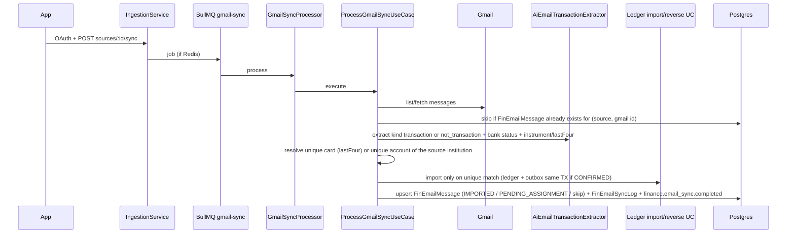

# Finance Module (Backend)

## Purpose

Personal finance domain for **Personal OS**: consolidate accounts, cards, and cash positions; record and categorize transactions; plan budgets and savings; track loans and receivables; and optionally import bank activity from **Gmail notification emails**. All data is scoped per authenticated user with Row Level Security (RLS) on Supabase/Postgres.

The module is consumed by:

- REST API under `/finance` (capability controllers)
- Mobile app (`personal-os-app`)
- Web app (`personal-os-web`) — `/finance` shell, catalog, ledger, budgets, planning, Gmail sync and review queue (`personal-os-web/docs/modules/finance.md`)
- AI agent tools when `moduleSlug=finance` (see `docs/ai-tools/finance-tools.md`) via **`FinanceFacade` only**. The facade is a subset of REST (see [REST vs FinanceFacade](#rest-vs-financefacade)).

## Architecture

Capability-first Nest modules under `src/modules/finance/`. The root is a **pure composition root**. House standard: [docs/architecture/modules.md](../architecture/modules.md).

`FinanceModule` imports capability modules and **exports only `FinanceFacade`** from Nest. The TypeScript barrel [`index.ts`](../../src/modules/finance/index.ts) is the cross-module import surface:

- `FinanceModule`, `FinanceFacade` — primary consumers (AI tools, app composition)
- `FinanceEventsModule`, `DomainEventIdempotencyGuard` — outbox consumers (notifications, ai-agent listeners)

There is no `FinanceService` / `FinanceRepository` / single god controller. Outside code must not import capability paths (`ledger/`, `events/`, …).

### Canonical shape per capability

```text
capability/
  capability.module.ts
  presentation/       # controllers + dto/ (omit if internal-only)
  application/        # services and/or use-cases; ports/ when needed
  infrastructure/     # Prisma repos, external adapters
```

Shared pure rules live in `shared/domain/` (`Money`, ledger rules, mappers). Do **not** invent empty per-capability `domain/` folders until a capability owns rules that are not shared.

### Use-case vs fat service

| Style | When | Examples today |
| --- | --- | --- |
| **Use-cases** (`*.use-case.ts`) | Distinct write flows with different rules/orchestration | ledger writes, ingestion sync, FX `ResolveAmountsUseCase` |
| **Fat application service** | CRUD / read-heavy or a single cohesive API surface | catalog, planning, analytics |
| **Ports** | Cross-capability contract or ≥2 adapters | `LEDGER_REPOSITORY`, `BUDGET_THRESHOLD_PORT`, FX / email extractor ports |

Query-only surfaces (e.g. `LedgerQueryService`) stay as services even when writes are use-cases.

### Ledger vs side effects

- **Ledger** write use-cases orchestrate FX + `LEDGER_REPOSITORY`; **`LedgerQueryService` only lists/gets**.
- **Ledger** mutators run **synchronously** inside one `prisma.$transaction`: transaction row + balances + budget `amountSpent` + outbox row(s) + optional threshold side effects via `BUDGET_THRESHOLD_PORT`.
- **Delete transaction**: hard-deletes and restores balances in the same TX and enqueues `finance.transaction.deleted` (notifications claim it and stay silent). Use `POST /finance/transactions/:id/reverse` for an auditable compensating change: the original row is kept as `REVERSED` and `finance.transaction.reversed` is enqueued. Reverse is idempotent if already `REVERSED`. HTTP reverse is limited to `CONFIRMED` non-transfer rows (one transfer leg → 400). Gmail sync still calls the use case directly for bank reversals.
- **Email sync completed**: `FinEmailSyncLog` + `finance.email_sync.completed` outbox row land in the **same** `$transaction` as the sync success path.
- **Side effects** (notifications, AI insights, WebSocket) run **after commit** via `DomainEventOutbox` → `FinanceOutboxDispatcher` (cron every 30s + wake after write) → `EventEmitter2`.
- Listeners call `DomainEventIdempotencyGuard.tryClaim(eventId, consumer)` before acting.
- Not event sourcing: outbox is delivery durability only.

### Dependency rules

- Outside code imports **`FinanceFacade`** only (AI tools already do).
- Ledger does **not** import full Planning module; it uses `FinancePlanningThresholdModule` + `BUDGET_THRESHOLD_PORT`.
- Ingestion orchestrates extractor + FX + ledger import/reverse use-cases; `GmailSyncProcessor` only calls `ProcessGmailSyncUseCase`.

## Features

| Area | Capability |
| --- | --- |
| Institutions | User-defined banks/fintechs; soft-delete via `isActive` |
| Accounts | Checking, savings, investment **require** an institution; `CASH` may omit it; **not** cards (`lastFour` lives on `FinCard`) |
| Cards | Credit/debit per institution; `lastFour` identifies the PAN; multi-currency balances + credit limit on `FinCardBalance`; statement days on card |
| Transactions | Manual CRUD (`DEBIT`/`CREDIT`); transfers via dedicated endpoint; filters; confirm `PENDING`; reverse `CONFIRMED` via `POST /transactions/:id/reverse` (row stays `REVERSED`; one transfer leg is 400) |
| Categories | System + custom; hierarchical (`parentId`); used by budgets and transactions |
| Budgets | Per category and period; spent tracking; threshold alerts deduped in `FinBudgetAlert`. `GET /finance/budgets` is **paginated** (`{ items, pagination }`, default `page=1` `limit=20`, cap 100). |
| Savings goals | Target amount, progress, completion (`isCompleted` recalculated on amount changes) |
| Loans / receivables | Loans archive via `PATCH isActive` / `DELETE`. Optional catalog `institutionId` (bank lender) plus `lenderName` (display / external lender). `accountId` is the **payment account**; PATCH honors it and requires the same institution when the lender is catalogued. Optional `currency` (ISO 4217, default `DOP`), `interestRate` as a **fraction 0–1** (`Decimal(5,4)`, e.g. `0.12` = 12%; `null` = not provided, distinct from `0`), and `notes`. Receivables: `status` (`PENDING` \| `PARTIAL` \| `PAID` \| `CANCELLED`) and `paidAmount` on PATCH; `paidAmount` ∈ [0, amount]; `PAID` requires `paidAmount = amount` (omitted `paidAmount` is filled); omitting `status` derives it from amounts; `CANCELLED` does not require a full payment |
| Gmail sync | OAuth2 on `FinEmailConnection`; `FinEmailSource` is connection + **institution** + `bankDomain`. Card last-four / unique account match imports; 0 or N → `PENDING_ASSIGNMENT`. Tokens encrypted. BullMQ job. **AI extraction**. Requires `userModules.finance.config.emailSync.enabled`. |
| Analytics | Net worth, cash flow, spending by category, budget status. `GET /analytics/summary` positions (`accountBalance`, `cardDebt`, `netWorth`) are converted to `BASE_CURRENCY` using the **UTC date of the request** (exact cached/API rate, same fail-closed 400 as ledger — no stale “latest”). Income/expenses already use `amountBaseCurrency`. Payload includes `baseCurrency`. |
| FX | Live historical rates via **exchangerate.host**; cache in `FinExchangeRate` (exact date only) |

**Out of scope (today):** open banking APIs, automatic balance reconciliation from bank cores, and **`fin_recurring_patterns` / `FinRecurringPattern`** (schema reserved; no REST, no facade, no tools).

## Data model

Prefix: `fin_*` tables. Primary keys are UUID text columns.

### Core tables (selected)

| Model | Description |
| --- | --- |
| `FinTransaction` | Ledger row; XOR account/card; optional unique `emailMessageId` FK to `FinEmailMessage.id` |
| `FinEmailConnection` | OAuth mailbox (tokens); unique `(userId, provider, emailAddress)` |
| `FinEmailSource` | Bank-domain filter for one connection + institution (not OAuth, not a ledger target) |
| `FinEmailMessage` | Per-source Gmail extract (`gmailMessageId` is the provider id); outcomes include `PENDING_ASSIGNMENT` |
| `FinEmailSyncLog` | One row per sync run |
| `FinExchangeRate` | Cached pair rates by calendar date |
| `FinBudgetAlert` | Threshold alerts; unique `(budget_id, type)` for dedupe |
| `DomainEventOutbox` | Durable domain events |
| `ProcessedDomainEvent` | Consumer idempotency (`eventId` + `consumer`) |
| `FinRecurringPattern` | Reserved (`fin_recurring_patterns`). **No API.** Out of scope. |

### Transaction amount fields

| Field | Meaning |
| --- | --- |
| `amount` / `currency` | Original amount as entered or extracted |
| `ledgerAmount` / `ledgerCurrency` | Amount applied to account/card balance |
| `amountBaseCurrency` / `exchangeRate` | Analytics normalization (`BASE_CURRENCY`) |

FX fails closed: if the exact historical rate for `transactionDate` is missing from cache and API, the operation returns 400 — no stale “latest” rate. The same rule applies to `GET /finance/analytics/summary` positions using today’s UTC date.

### Money JSON contract

Response bodies (not write DTOs) serialize **money and rates as decimal strings** with the same helper as ledger/catalog (`decimalToString`). Request bodies stay `@IsNumber`. Percentages stay `number`.

| Kind | JSON type | Examples |
| --- | --- | --- |
| Money | string | `amount`, `balance`, `ledgerAmount`, `netWorth`, `cashFlow`, `totals.*`, spending `total`, `amountLimit`, `amountSpent`, `originalAmount`, `paidAmount` |
| Rate | string or `null` | `interestRate` (`"0.12"` = 12%; `null` = not set, distinct from `"0"`) |
| Percentage | number | `pctUsed`, `threshold`, `alertThresholdPct` |

### Enums (transactions)

| Enum | Values |
| --- | --- |
| `FinTransactionType` | `DEBIT`, `CREDIT`, `TRANSFER` (transfer type used on paired legs) |
| `FinTransactionStatus` | `PENDING`, `CONFIRMED`, `DECLINED`, `CANCELLED`, `REVERSED` |
| `FinTransactionSource` | `MANUAL`, `EMAIL`, `AI` |
| `FinEmailMessageOutcome` | `IMPORTED`, `SKIPPED_NOT_TX`, `FAILED_NON_RETRYABLE`, `PENDING_ASSIGNMENT` |

User language **COMPLETED** maps to **CONFIRMED** (no `COMPLETED` enum value).

### Transaction rules

- **Target XOR**: exactly one of `accountId` or `cardId`.
- **Ownership**: institution of an account/card belongs to the user; DEBIT cards use an account of the same user and institution; CREDIT cards have no account; category of a transaction/budget is the user's or system; category parent is visible, acyclic, and same-user; loan payment account belongs to the user (and the same institution when the lender is catalogued). Changing an account's institution is rejected while incompatible debit cards remain. Archiving an institution is **409** while active accounts, cards, email sources, or loans remain. Those 409s include `details.dependents` or `details.debitCardIds` so the client can act on the conflict.
- **Ledger effects** only when status is `CONFIRMED` (create or confirmation path).
- `POST /transactions` accepts `type` `DEBIT` \| `CREDIT` only; use `POST /transfers` for moves.
- Email import status comes from **bank status mapping** (domain), not always `PENDING`.
- Manual defaults: `CONFIRMED`, `source=MANUAL`. AI tools create with `source=AI`.

### Bank status → internal status (email)

AI extractor returns `bankStatusNormalized` + `statusConfidence`. Domain rules (`shared/domain/transaction-status.ts`):

| Confidence / bank status | Internal |
| --- | --- |
| confidence &lt; 0.7 or `UNKNOWN` | `PENDING` |
| `APPROVED` / `COMPLETED` / `POSTED` | `CONFIRMED` (ledger) |
| `PENDING` / `IN_PROGRESS` / `AUTHORIZED` | `PENDING` |
| `DECLINED` / `REJECTED` / `FAILED` | `DECLINED` |
| `CANCELLED` / `VOIDED` | `CANCELLED` |
| `REVERSED` / `REFUNDED` / `CHARGEBACK` | reverse original if found + `REVERSED` |

Evidence and model metadata stored in `aiMetadata`.

## API endpoints

Base path: `/finance`. Auth: Bearer JWT (`@ApiBearerAuth`). Controllers are split by capability; HTTP paths and `{ data, meta }` envelope are unchanged relative to the prior monolithic controller.

Authenticated `/finance/*` routes also require `user_modules.finance.isEnabled`. A missing `UserModule` row or `isEnabled: false` returns **403** with `Finance module is disabled` (not 404). The Gmail OAuth callback stays `@Public()` and does not check the toggle — Google's redirect has no Bearer token.

| Area | Controllers |
| --- | --- |
| Ledger | `TransactionsController`, `TransfersController` |
| Catalog | Institutions, Accounts, Cards, Categories |
| Planning | Budgets, Savings goals, Loans, Receivables |
| Analytics | `AnalyticsController` (`summary`, spending, budget-status) |
| Ingestion | `EmailSyncController` (OAuth + sources + sync + pending assignment) |

Public OAuth callback remains on the email-sync controller. After Google consent the API redirects:

- **Mobile (default):** `personal-os://finance/oauth/callback?success=1|false`
- **Web:** pass `returnTo` (https URL whose origin is in `CORS_ORIGIN`) when requesting `GET /finance/email-sync/oauth/google/url`. The signed `state` carries `returnTo` plus required `institutionId`. The callback then 302s to `{returnTo}?success=true|false`. Invalid or missing `returnTo` falls back to the mobile deep link (no open redirect). Connect/sync also require `emailSync.enabled` in the finance module config.

### List shapes

Envelope is always `{ data, meta }`. Inside `data`:

| Endpoint | Shape | Notes |
| --- | --- | --- |
| `GET /finance/transactions` | `{ items, pagination }` | Default `page=1` `limit=20`, max 100 |
| `GET /finance/budgets` | `{ items, pagination }` | Same defaults; grows with periods |
| `GET /finance/accounts`, `cards`, `institutions`, `categories` | array | Unbounded catalog for pickers (personal scale) |
| `GET /finance/savings-goals`, `loans`, `receivables` | array | Unbounded |
| `GET /finance/email-sync/sources` | array | Sync logs nested `take: 5` (detail `take: 10`); no tokens |
| `GET /finance/email-sync/pending` | array | `PENDING_ASSIGNMENT` messages for the review queue |
| `GET /finance/analytics/*` | object | Not paginated |

AI `list_budgets` still uses `FinanceFacade.listBudgets` (full array), not the HTTP page.

### REST vs FinanceFacade

Chat tools call **`FinanceFacade` only**. REST under `/finance` is wider. Do not treat the tool list as the HTTP surface.

| Capability | REST | `FinanceFacade` / AI tools |
| --- | --- | --- |
| Create loan | `POST /finance/loans` | No (`listLoans` + `updateLoan` only) |
| Receivables | list / create / PATCH | No |
| Institutions, accounts, cards **writes** (create, archive, balances) | Yes | Lists only (`listAccounts`, `listCards`) |
| Categories writes | Yes | `listCategories` only |
| Delete transaction | `DELETE /finance/transactions/:id` | No |
| Reverse transaction | `POST /finance/transactions/:id/reverse` | Yes (`reverseTransaction`); **no** AI tool yet |
| Gmail OAuth (URL + public callback, `returnTo` / `institutionId`) | Yes | No (`listEmailSources` + `triggerEmailSync` only) |
| Pending email assignment | `GET /finance/email-sync/pending`, `POST .../pending/:id/assign`, `POST .../pending/:id/retry` | No |
| Paginated budgets | `GET /finance/budgets` → `{ items, pagination }` | Unbounded `listBudgets` array |

Full tool list: `docs/ai-tools/finance-tools.md`.

## Gmail sync pipeline



| Step | Behavior |
| --- | --- |
| Preconditions | Source active; connection tokens; `emailSync.enabled`; institution owned |
| Query | `from:{bankDomain}` + `after` unless `forceFullSync` |
| Dedup | Skip if `FinEmailMessage` already exists for `(sourceId, gmailMessageId)` |
| Extraction | LLM + Zod discriminated union (`kind: transaction` \| `not_transaction`); `instrumentHint` + card `lastFourHint`; no HTML parsers |
| Routing | Unique **card** match on last-four, or unique **account** of that institution when the hint is ACCOUNT; 0 or N → `PENDING_ASSIGNMENT` (no ledger row) |
| Non-tx / failures | `not_transaction` → `SKIPPED_NOT_TX`; `ok: false` + `retryable: false` → `FAILED_NON_RETRYABLE` (no re-extract); `retryable: true` not persisted |
| Review | `GET /finance/email-sync/pending`; `POST .../assign` XOR account/card of the same institution; `POST .../retry` re-runs the resolver. Both are idempotent if already `IMPORTED`. |
| Status | Domain map from bank status + confidence (transaction kind only) |
| Batch AI/notifications | Prefer `finance.email_sync.completed` over per-email storms for EMAIL source |

Without Redis, `POST .../sync` returns `{ queued: false, reason: '...' }`.

## Domain events

**Versioned names only** (no dual legacy enqueue). Written to `domain_event_outbox` then dispatched:

| Event | Consumers |
| --- | --- |
| `finance.transaction.confirmed` / `imported` / `declined` / `cancelled` / `reversed` | Notifications, AI (EMAIL per-row insights skipped; batch sync used) |
| `finance.transaction.updated` | Notifications, AI |
| `finance.transaction.deleted` | AI (notifications claim idempotency and stay silent — no in-app toast) |
| `finance.budget.threshold_crossed` | Notifications, AI (once per budget/type via alerts table) |
| `finance.email_sync.completed` | AI batch insight |
| `finance.transfer.created` | Outbox for transfer aggregate |
| `finance.email_sync.failed` | Ops / future consumers |

Catalog: `src/core/events/event.constants.ts`.

## Environment

| Variable | Purpose |
| --- | --- |
| `GOOGLE_CLIENT_ID` / `GOOGLE_CLIENT_SECRET` / `GOOGLE_REDIRECT_URI` | Gmail OAuth |
| `ENCRYPTION_KEY` | ≥32 chars; OAuth token encryption |
| `REDIS_ENABLED` + `REDIS_URL` | BullMQ for Gmail sync and AI processing |
| `EXCHANGE_RATE_HOST_API_KEY` | exchangerate.host historical rates |
| `BASE_CURRENCY` | Analytics base (e.g. `DOP`) |

## AI integration

Tools call **`FinanceFacade`** (not raw repositories). That surface is a **subset of REST** — see [REST vs FinanceFacade](#rest-vs-financefacade). Full tool list: `docs/ai-tools/finance-tools.md`. Finance tools call `UsersService.assertModuleEnabled` first; a disabled module returns a tool error (`Tool execution failed: Finance module is disabled`) instead of hitting the facade.

Email extraction uses `AiService.chatComplete` via `AiEmailTransactionExtractor` (`EMAIL_TRANSACTION_EXTRACTOR` token). Ingestion imports `AiCoreModule` (AI provider kernel) rather than `AiModule`, so there is no Nest cycle with Finance. The extractor injects `AiService` directly (no `forwardRef`).

## Security

- RLS on user-owned finance tables.
- Gmail tokens encrypted; OAuth state JWT-bound.
- Gmail scope is read-only mail.
- REST (`EnabledModuleGuard` + `@RequiresEnabledModule('finance')`) and AI finance tools refuse access when the module is off.

## Smoke checklist (HTTP real)

Target: Nest local + real `DATABASE_URL` + FX key + real user JWT. **Not** a live Gmail cycle.

```bash
# 1) API running with DATABASE_URL, EXCHANGE_RATE_HOST_API_KEY, BASE_CURRENCY
# 2) User with ≥2 accounts (script creates them if missing)

SMOKE_BASE_URL=http://127.0.0.1:3000/api \
SMOKE_JWT=<jwt> \
pnpm exec ts-node -r tsconfig-paths/register prisma/scripts/smoke-finance-http.ts
```

Script covers: multi-currency create → PENDING + confirm → transfer → outbox rows for `finance.transaction.*` / `finance.transfer.created` → cleanup of tagged smoke rows. Success prints `{"SMOKE_RESULT":"PASS"}`.

**Last smoke run (2026-08-07):** PASS against local Nest with a real Supabase JWT (or e2e HS256 overrides via `test/helpers/auth-test.providers.ts` — never `NODE_ENV=test` on the production auth path), port 3456, real Supabase `DATABASE_URL` + FX. Observations:

- Multi-FX DEBIT USD on DOP account → 201; `ledgerAmount` 145.63 (≠ raw amount)
- PENDING create + confirm → CONFIRMED
- Transfer group `f108dadc-…` → 201
- Outbox: 7 rows (`finance.transaction.*`, `finance.transfer.created`) status `COMPLETED` after dispatcher wake
- Cleanup: 4 txs + 2 smoke accounts deleted

Automated substitute without live HTTP: `pnpm test:e2e --testPathPatterns=finance` (Prisma mock).

## Related documentation

- App UI (mobile): `personal-os-app/docs/modules/finance.md`
- Web UI (stub until screens ship): `personal-os-web/docs/modules/finance.md`
- AI tools: `docs/ai-tools/finance-tools.md`
- Core events/outbox overview: `docs/core-infrastructure.md`
- Migration: `prisma/migrations/20260807120000_finance_hexagonal_events_fx/`
- HTTP smoke script: `prisma/scripts/smoke-finance-http.ts`
