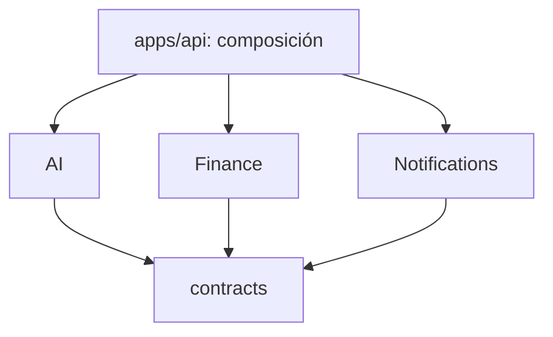

# Contratos y composición propuestos

Estado: `NO_IMPLEMENTADO`; seguimiento en [#193](https://github.com/jarvinc3/personal-os-back/issues/193).
Las firmas revisables están en [contracts.draft.ts](artifacts/contracts.draft.ts).
El paquete futuro `@personal-os/contracts` exporta tipos y símbolos JavaScript:
no importa Nest, Prisma, SDK de IA, Finance ni Notifications.

El grafo es el destino de la separación, no una afirmación sobre AI-0 completo.
En AI-0 se desacopla la inferencia genérica; Notifications todavía depende de
FinanceEventsModule hasta mover el relay y el guard de eventos de plataforma.

| Contrato                                | Dueño de implementación    | Regla                                                                                     |
| --------------------------------------- | -------------------------- | ----------------------------------------------------------------------------------------- |
| InferenceCompletionPort                 | AI                         | Conservar pool, fallback y pruebas de AiService; retirar chat como nombre del puerto      |
| AiCapabilityProvider                    | Cada dominio               | AI recibe capacidades registradas, nunca importa implementaciones financieras             |
| SettingsDescriptor                      | Cada app                   | Defaults, normalización, patch y preferencias pertenecen al dominio                       |
| ModuleSettingsReader                    | Composición / persistencia | Leer mediante descriptor; migrar settings válidos existentes sin pérdida silenciosa       |
| IntentProducer / NotificationIntentSink | Dominio / Notifications    | Deduplicación obligatoria y persistencia antes del aviso externo                          |
| DomainEventPublisher                    | Plataforma                 | Enqueue con la misma transacción que el efecto; el parámetro transaccional es obligatorio |
| SignalConsumer                          | Dominio                    | Devuelve resultado; AI conserva la propiedad del estado de Signals                        |

`apps/api` registra providers y descriptores mediante fábricas y tokens. Finance,
AI y Notifications no se importan entre sí para obtener estas capacidades.
Agenda, Proyectos y Salud usan descriptores estáticos en
`apps/api/src/module-settings/descriptors/` mientras no tengan paquete propio.
Cuando exista el paquete, el descriptor se mueve allí sin crear un módulo Nest
ficticio. El registro es composición, no un segundo catálogo de defaults.

El contexto de ejecución lo construye el servidor después de autenticar al
usuario y autorizar la capacidad. Nunca se aceptan del modelo `userId`, permisos,
aprobación ni el digest de argumentos como evidencia de autorización. Confirmar
una acción exige comparar actor, capacidad, argumentos y estado con la fila
persistida; las interfaces por sí solas no implementan esa garantía.

La importación financiera tiene su propio [puerto](artifacts/finance-import.draft.ts).
No va al paquete neutral. AI-0 cambia mecánicamente `emailMessageId` por
`importReference` y separa fuentes de candidatos; conserva algoritmos, fixtures y
pruebas. El adaptador persistente de candidatos y el consumidor de Signals llegan
en FIN-3/AI-11. Ningún worker dormido se registra durante el corte.

Los montos internos conservan el contrato numérico actual durante AI-0. FIN-3
definirá la representación decimal canónica de Signals y su conversión con
pruebas de precisión; no se mezcla ese cambio con la eliminación de Gmail.
